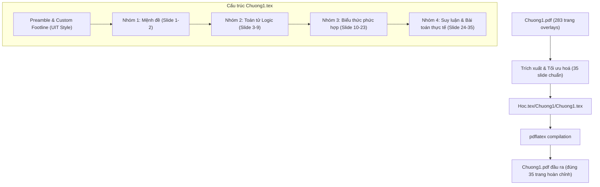

# Chuyển đổi Slide Chương 1 sang LaTeX Beamer Implementation Plan

> **For agentic workers:** REQUIRED SUB-SKILL: Use superpowers:subagent-driven-development to implement this plan task-by-task. Steps use checkbox (`- [ ]`) syntax for tracking.

**Goal:** Chuyển đổi toàn diện nội dung từ slide bài giảng [Chuong1.pdf](file:///home/fullstuck_developer/Workspace/CITD/HocHanh/CauTrucRoiRac/Hoc/Chuong1.pdf) thành mã nguồn LaTeX Beamer trong file đơn nhất [Chuong1.tex](file:///home/fullstuck_developer/Workspace/CITD/HocHanh/CauTrucRoiRac/Hoc.tex/Chuong1/Chuong1.tex), tạo ra đúng 35 slide chuẩn tỉ lệ 16:9 với footline và màu sắc UIT chuẩn xác.

**Architecture:** Sử dụng `\documentclass[aspectratio=169, 11pt]{beamer}` với nền trắng phẳng (`default`), tùy biến footline 3 khoang (Tác giả | Môn học | Số trang). Toàn bộ nội dung gồm 35 frames được tổ chức thành 4 phân mục logic rõ ràng. Các bảng chân trị và quy tắc suy luận được thiết kế bằng `tabular` và `array` chuẩn xác. Biên dịch và nghiệm thu bằng `pdflatex`.

**Architecture Diagram:**



**Tech Stack:**
- LaTeX / TeXLive (`pdflatex`)
- Beamer class (`aspectratio=169`)
- Vietnamese font support (`babel`, `fontenc T5`, `utf8 inputenc`)
- Math packages (`amsmath`, `amssymb`, `amsfonts`)

**Spec:** [docs/superpowers/specs/2026-10-21-chuong1-latex-beamer-design.md](file:///home/fullstuck_developer/Workspace/CITD/HocHanh/CauTrucRoiRac/docs/superpowers/specs/2026-10-21-chuong1-latex-beamer-design.md)

## Global Constraints

- File đích duy nhất: [Hoc.tex/Chuong1/Chuong1.tex](file:///home/fullstuck_developer/Workspace/CITD/HocHanh/CauTrucRoiRac/Hoc.tex/Chuong1/Chuong1.tex)
- Tỉ lệ khung hình: 16:9 (`aspectratio=169`), cỡ chữ 11pt
- Màu tiêu đề: `RGB(0, 0, 204)` (`uitblue`), không thanh navigation
- Footline: 3 khoang màu xanh chuẩn `TS. Nguyễn Văn Hợi | UIT – Cấu Trúc Rời Rạc | \insertframenumber{} / 35`
- Không sử dụng các bước hiệu ứng lặp `\pause` gây nhân bản trang
- Biên dịch thành công 100% bằng `pdflatex` không có lỗi

---

### Task 1: Khởi tạo thư mục và Preamble với Custom Footline UIT

**Files:**
- Create: `Hoc.tex/Chuong1/Chuong1.tex`

**Interfaces:**
- Consumes: Spec mục 2 (Cấu trúc Preamble & Theme Beamer)
- Produces: Khung sườn tài liệu LaTeX Beamer hoàn chỉnh có thể biên dịch thành công 1 trang demo

- [ ] **Step 1: Viết cấu hình Preamble, Footline và khung văn bản mẫu**

Tạo file [Chuong1.tex](file:///home/fullstuck_developer/Workspace/CITD/HocHanh/CauTrucRoiRac/Hoc.tex/Chuong1/Chuong1.tex) với cấu trúc:
```latex
\documentclass[aspectratio=169, 11pt]{beamer}

\usepackage[utf8]{inputenc}
\usepackage[T5]{fontenc}
\usepackage[vietnamese]{babel}
\usepackage{amsmath, amssymb, amsfonts}
\usepackage{array, tabularx, booktabs}
\usepackage{xcolor}

\setbeamertemplate{navigation symbols}{}
\setbeamercolor{background canvas}{bg=white}

\definecolor{uitblue}{RGB}{0, 0, 204}
\definecolor{footleft}{RGB}{0, 0, 204}
\definecolor{footmid}{RGB}{0, 0, 153}
\definecolor{footright}{RGB}{0, 0, 115}

\setbeamercolor{frametitle}{fg=uitblue}
\setbeamerfont{frametitle}{series=\bfseries, size=\large}

\setbeamertemplate{footline}{%
  \leavevmode%
  \hbox{%
    \begin{beamercolorbox}[wd=.333333\paperwidth,ht=2.5ex,dp=1ex,left]{footleftbox}%
      \hspace*{2ex}\textbf{\color{white}\small TS. Nguyễn Văn Hợi}%
    \end{beamercolorbox}%
    \begin{beamercolorbox}[wd=.333333\paperwidth,ht=2.5ex,dp=1ex,center]{footmidbox}%
      \textbf{\color{white}\small UIT -- Cấu Trúc Rời Rạc}%
    \end{beamercolorbox}%
    \begin{beamercolorbox}[wd=.333334\paperwidth,ht=2.5ex,dp=1ex,right]{footrightbox}%
      \textbf{\color{white}\small \insertframenumber{} / 35}\hspace*{2ex}%
    \end{beamercolorbox}%
  }%
  \vskip0pt%
}

\begin{document}

\begin{frame}{Khung mẫu}
Khởi tạo cấu trúc Beamer thành công.
\end{frame}

\end{document}
```

- [ ] **Step 2: Biên dịch thử nghiệm để xác thực khung Preamble**

Run: `pdflatex -interaction=nonstopmode -output-directory=Hoc.tex/Chuong1 Hoc.tex/Chuong1/Chuong1.tex`
Expected: Biên dịch ra `Hoc.tex/Chuong1/Chuong1.pdf` thành công với mã thoát 0, footline hiển thị đầy đủ 3 khoang.

---

### Task 2: Soạn thảo Nhóm 1 - Khái niệm Mệnh đề và Phân loại (Slide 1 -- 2)

**Files:**
- Modify: `Hoc.tex/Chuong1/Chuong1.tex`

**Interfaces:**
- Consumes: Slide 1 và Slide 2 từ `Hoc/Chuong1.pdf`
- Produces: 2 frame hoàn chỉnh đầu tiên của tài liệu

- [ ] **Step 1: Cập nhật nội dung Slide 1 và Slide 2 vào file**

Thay thế frame mẫu bằng Slide 1 và Slide 2:
- **Slide 1 (`frametitle{Mệnh đề là gì?}`):**
  - Định nghĩa mệnh đề: "Một **mệnh đề** là một câu khẳng định một sự kiện: nó phải có giá trị **Đúng** hoặc **Sai**, nhưng không thể vừa đúng vừa sai."
  - Ví dụ về Mệnh đề:
    - `"Hà Nội là thủ đô của Việt Nam."` $\to$ Mệnh đề Đúng.
    - `"0 > e"` hoặc `"0 > 2."` $\to$ Mệnh đề Sai.
    - `"3 là một số nguyên tố."` $\to$ Mệnh đề Đúng.
  - Phản ví dụ:
    - `"x > 3"` $\to$ Chưa xác định được Đúng/Sai.
    - `"Mấy giờ rồi?"` $\to$ Câu hỏi, không phải mệnh đề.
    - `"Hãy đọc kĩ điều này!"` $\to$ Câu mệnh lệnh, không phải mệnh đề.
- **Slide 2 (`frametitle{Ký hiệu và Phân loại}`):**
  - Các chữ cái $p, q, r, s...$ được dùng làm biến mệnh đề.
  - Chân trị (Truth value): Đúng biểu diễn bởi $1$ (hoặc $\mathbf{T}$, Đ); Sai biểu diễn bởi $0$ (hoặc $\mathbf{F}$, S).
  - Phân loại: Mệnh đề sơ cấp (nguyên tử) và Mệnh đề phức hợp (tạo thành từ các toán tử logic).

- [ ] **Step 2: Biên dịch và kiểm tra hiển thị 2 slide đầu**

Run: `pdflatex -interaction=nonstopmode -output-directory=Hoc.tex/Chuong1 Hoc.tex/Chuong1/Chuong1.tex`
Expected: Xuất file PDF 2 trang, định dạng rõ ràng, đúng chính tả tiếng Việt.

---

### Task 3: Soạn thảo Nhóm 2 - Các toán tử Logic cơ bản (Slide 3 -- 9)

**Files:**
- Modify: `Hoc.tex/Chuong1/Chuong1.tex`

**Interfaces:**
- Consumes: Slide 3 đến 9 từ `Hoc/Chuong1.pdf`
- Produces: 7 frame (Slide 3 đến Slide 9) bao gồm 1 slide divider [plain] và 6 slide nội dung các toán tử

- [ ] **Step 1: Soạn thảo Slide 3 đến Slide 9**

Thêm các frame:
- **Slide 3:** Frame phân mục `[plain]`:
  ```latex
  \begin{frame}[plain]
    \centering
    \vspace*{2cm}
    {\Huge\textbf{\color{uitblue}2. Các toán tử Logic}}
    \par\vspace{0.5cm}
    \rule{0.6\textwidth}{1.2pt}
  \end{frame}
  ```
- **Slide 4:** `1. Phép phủ định (NOT)`:
  - Ký hiệu $\neg p$ hoặc $\bar{p}$.
  - Bảng chân trị 2 dòng ($p=0 \to \bar{p}=1; p=1 \to \bar{p}=0$).
- **Slide 5:** `2. Phép hoặc (OR) và 3. Phép giao (AND)`:
  - Định nghĩa phép tuyển $p \lor q$ và phép hội $p \land q$.
  - 2 bảng chân trị đặt song song sử dụng 2 cột `columns` hoặc 2 `tabular` cạnh nhau.
- **Slide 6:** `4. Phép tuyển loại (XOR)`:
  - Ký hiệu $p \oplus q$. Bảng chân trị (đúng khi và chỉ khi đúng 1 trong 2).
  - Ví dụ thực tế: "Bữa ăn kèm súp hoặc salad".
- **Slide 7:** `5. Phép kéo theo và 6. Phép tương đương`:
  - Ký hiệu $p \rightarrow q$ ("nếu $p$ thì $q$") và $p \leftrightarrow q$ ("$p$ khi và chỉ khi $q$").
  - Phân biệt điều kiện cần, điều kiện đủ.
  - 2 bảng chân lý hoàn chỉnh.
- **Slide 8:** `Hiểu phép kéo theo qua một lời hứa`:
  - Phân tích lời hứa phụ huynh: "Nếu con được điểm 10 toán thì bố thưởng 100k".
  - Phân tích chi tiết 4 trường hợp chân trị chứng minh vì sao $0 \rightarrow 0$ là Đúng và $0 \rightarrow 1$ là Đúng.
- **Slide 9:** `Kiểm tra nhanh`:
  - Các câu hỏi trắc nghiệm nhanh kiểm tra chân trị với đáp án tương ứng.

- [ ] **Step 2: Biên dịch và kiểm tra**

Run: `pdflatex -interaction=nonstopmode -output-directory=Hoc.tex/Chuong1 Hoc.tex/Chuong1/Chuong1.tex`
Expected: PDF hiện có 9 trang (từ slide 1 đến 9), các bảng chân trị ngay ngắn, không tràn lề.

---

### Task 4: Soạn thảo Nhóm 3 - Biểu thức phức hợp & Tương đương Logic (Slide 10 -- 23)

**Files:**
- Modify: `Hoc.tex/Chuong1/Chuong1.tex`

**Interfaces:**
- Consumes: Slide 10 đến 23 từ `Hoc/Chuong1.pdf`
- Produces: 14 frame (Slide 10 đến Slide 23)

- [ ] **Step 1: Soạn thảo Slide 10 đến Slide 23**

Thêm các frame:
- **Slide 10:** Frame phân mục `[plain]` với tiêu đề `3. Biểu thức phức hợp`.
- **Slide 11:** `Bảng chân lý của các Mệnh đề phức hợp`:
  - Bảng chân trị các cột: $p, q, \neg q, p \lor \neg q, p \land q, (p \lor \neg q) \rightarrow (p \land q)$.
- **Slide 12:** `Ví dụ 2: Kiểm tra tương đương logic`:
  - Bảng so sánh chân trị của $\neg(p \lor q)$ và $\neg p \land \neg q$ (Chứng minh Luật De Morgan).
  - Ký hiệu tương đương logic $\equiv$ hoặc $\Leftrightarrow$.
- **Slide 13:** `Ví dụ 3: Biểu thức có 3 biến`:
  - Bảng chân trị 8 dòng ($p, q, r, p \lor q, (p \lor q) \rightarrow r$).
- **Slide 14:** `Bài tập: Chứng minh tương đương logic qua bảng chân lý`:
  - Đề bài câu (a), (b), (c).
- **Slide 15:** `Bảng các tương đương Logic (Phần 1)`:
  - Bảng tổng hợp: Luật đồng nhất, nuốt, lũy đẳng, phủ định kép, giao hoán, kết hợp, phân phối.
- **Slide 16:** `Lời giải: Câu (b)`:
  - Bảng chân lý chi tiết lời giải câu (b).
- **Slide 17:** `Lời giải: Câu (c)`:
  - Bảng chân lý chi tiết lời giải câu (c).
- **Slide 18:** `Bảng các tương đương Logic (Phần 2)`:
  - Bảng tổng hợp: Luật De Morgan, luật kéo theo, luật đảo/phản đảo, luật tương đương, luật hấp thụ.
- **Slide 19:** `Ví dụ: Chứng minh tương đương Logic`:
  - Các bước biến đổi đại số tương đương có nêu rõ tên luật áp dụng ở từng bước.
- **Slide 20:** `Ví dụ: Chứng minh một hằng đúng`:
  - Chứng minh mệnh đề là Tautology bằng chuỗi tương đương logic.
- **Slide 21:** `Bài tập: Áp dụng các luật logic`:
  - Đề bài 5 bài tập biến đổi đại số logic.
- **Slide 22:** `Lời giải: Bài 2`:
  - Từng bước biến đổi chi tiết.
- **Slide 23:** `Lời giải: Bài 5`:
  - Từng bước biến đổi chi tiết.

- [ ] **Step 2: Biên dịch và kiểm tra**

Run: `pdflatex -interaction=nonstopmode -output-directory=Hoc.tex/Chuong1 Hoc.tex/Chuong1/Chuong1.tex`
Expected: PDF hiện có 23 trang, các bảng chân trị lớn được định cỡ vừa vặn trang 16:9 (`\small` hoặc `\footnotesize` nếu cần).

---

### Task 5: Soạn thảo Nhóm 4 - Suy luận và Chứng minh & Bài toán thực tế (Slide 24 -- 35)

**Files:**
- Modify: `Hoc.tex/Chuong1/Chuong1.tex`

**Interfaces:**
- Consumes: Slide 24 đến 35 từ `Hoc/Chuong1.pdf`
- Produces: 12 frame (Slide 24 đến Slide 35), hoàn tất đủ 35 slide của Chương 1

- [ ] **Step 1: Soạn thảo Slide 24 đến Slide 35**

Thêm các frame:
- **Slide 24:** Frame phân mục `[plain]` với tiêu đề `5. Suy luận và Chứng minh`.
- **Slide 25:** `Các quy tắc suy luận (Phần 1)`:
  - Modus Ponens (Khẳng định), Modus Tollens (Phủ định), Tam đoạn luận giả thiết (Bắc cầu), Tam đoạn luận tuyển. Dùng `array` có gạch kẻ và dấu `\therefore`.
- **Slide 26:** `Các quy tắc suy luận (Phần 2)`:
  - Quy tắc Cộng (Addition), Rút gọn (Simplification), Hội (Conjunction), Phân giải (Resolution).
- **Slide 27:** `Bài tập: Kiểm tra tính hợp lệ của các lập luận`:
  - Đề bài 3 câu (a), (b), (c).
- **Slide 28 -- 30:** `Lời giải chi tiết: Bài (a), (b), (c)`:
  - Đặt giả thiết, hình thức hóa và dẫn giải theo các quy tắc suy luận từng bước.
- **Slide 31 -- 32:** `Bài toán thực tế`:
  - Đề bài và phân tích tình huống thực tế.
- **Slide 33:** `Bài toán: Đi bơi hay đi canô?`:
  - Đề bài câu đố logic cuộc dã ngoại.
- **Slide 34:** `Bài toán: Đặt mệnh đề và hình thức hóa`:
  - Đặt các biến mệnh đề $p, q, r, s...$ và các biểu thức tiền đề.
- **Slide 35:** `Bài toán: Lời giải`:
  - Bảng suy luận từng bước chứng minh để đưa ra kết luận đi bơi hay đi canô.

- [ ] **Step 2: Biên dịch và kiểm tra**

Run: `pdflatex -interaction=nonstopmode -output-directory=Hoc.tex/Chuong1 Hoc.tex/Chuong1/Chuong1.tex`
Expected: PDF đạt đúng 35 trang hoàn chỉnh, không có bất kỳ cảnh báo nghiêm trọng nào.

---

### Task 6: Thẩm định toàn diện và Đối chiếu Trực quan

**Files:**
- Test / Verify: `Hoc.tex/Chuong1/Chuong1.pdf` vs `Hoc/Chuong1.pdf`

- [ ] **Step 1: Biên dịch lại toàn bộ tài liệu 2 lượt để ổn định tham chiếu và số trang**

Run: `pdflatex -interaction=nonstopmode -output-directory=Hoc.tex/Chuong1 Hoc.tex/Chuong1/Chuong1.tex`
Run: `pdflatex -interaction=nonstopmode -output-directory=Hoc.tex/Chuong1 Hoc.tex/Chuong1/Chuong1.tex`
Expected: Mã thoát 0, không có undefined references.

- [ ] **Step 2: Kiểm tra số trang bằng pdfinfo**

Run: `pdfinfo Hoc.tex/Chuong1/Chuong1.pdf | grep Pages`
Expected: `Pages: 35`

- [ ] **Step 3: Trích xuất và đối chiếu trực quan một số slide đại diện**

Run: `pdftoppm -png -r 150 -f 1 -l 2 Hoc.tex/Chuong1/Chuong1.pdf /tmp/verify_slide`
Expected: Các ảnh xuất ra hiển thị sắc nét, đúng font tiếng Việt, đúng bảng màu UIT và footline chuẩn xác.
