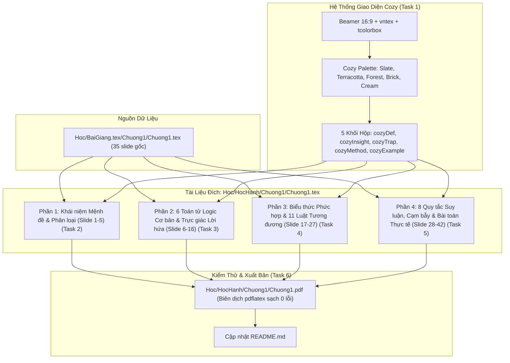

# Tái Cấu Trúc Sư Phạm & Visual Bài Giảng Cấu Trúc Rời Rạc Chương 1 Implementation Plan

> **For agentic workers:** REQUIRED SUB-SKILL: Use superpowers:subagent-driven-development to implement this plan task-by-task. Steps use checkbox (`- [ ]`) syntax for tracking.

**Goal:** Xây dựng lại hoàn chỉnh nội dung học tập Chương 1 (Logic Mệnh đề và Suy luận) tại `Hoc/HocHanh/Chuong1/Chuong1.tex` dưới dạng Beamer 16:9 với dải màu Cozy ấm áp, trực quan sinh động, giải thích trực giác bản chất toán học và cảnh báo cạm bẫy bài thi theo triết lý sư phạm 3 tầng.

**Architecture:** Sử dụng LaTeX Beamer tỉ lệ 16:9 kết hợp gói `tcolorbox` với các skin bo góc mềm mại và dải màu Cozy (Cozy Earth & Warm Slate). Nội dung được kế thừa $100\%$ lý thuyết từ [Hoc/BaiGiang.tex/Chuong1/Chuong1.tex](file:///home/fullstuck_developer/Workspace/CITD/HocHanh/CauTrucRoiRac/Hoc/BaiGiang.tex/Chuong1/Chuong1.tex), tái cấu trúc thành 4 phần logic (khoảng 42 slide), tích hợp các khung Trực giác (`cozyInsight`), Cạm bẫy (`cozyTrap`), Phương pháp (`cozyMethod`), Định nghĩa (`cozyDef`) và Ví dụ (`cozyExample`).

**Architecture Diagram:**



**Tech Stack:** LaTeX (TeX Live `pdflatex`), `beamer` class (aspect ratio 16:9), `vntex` (`T5`, `vietnamese`), `amsmath`, `amssymb`, `tcolorbox`, `tikz`, `booktabs`, `tabularx`, `xcolor`.

**Spec:** [docs/superpowers/specs/2026-10-22-chuong1-logic-menh-de-design.md](file:///home/fullstuck_developer/Workspace/CITD/HocHanh/CauTrucRoiRac/docs/superpowers/specs/2026-10-22-chuong1-logic-menh-de-design.md)

## Global Constraints

- Trình biên dịch: `pdflatex -interaction=nonstopmode -output-directory=Hoc/HocHanh/Chuong1 Hoc/HocHanh/Chuong1/Chuong1.tex`
- Tỉ lệ khung hình: `aspectratio=169`, font size `10pt`
- Bảng mã: UTF-8 với `\usepackage[T5]{fontenc}` và `\usepackage[vietnamese]{babel}`
- Dải màu Cozy: `cozySlate` (#2C3E50), `cozyBg` (#FAF8F5), `cozyWarm` (#D35400), `cozyTrue` (#2E7D32), `cozyFalse` (#C0392B), `cozyAmber` (#E67E22), `cozyMuted` (#7F8C8D)
- Không có lỗi biên dịch (Exit code 0), hạn chế tối đa Overfull `\hbox`
- Lưu giữ đầy đủ 100% các ví dụ, bài tập và mệnh đề từ file gốc của thầy Hợi

---

### Task 1: Thiết lập Preamble Beamer, Bảng màu Cozy & Hệ thống Khối Hộp `tcolorbox`

**Files:**
- Create/Modify: `Hoc/HocHanh/Chuong1/Chuong1.tex`
- Test: Lệnh biên dịch `pdflatex -interaction=nonstopmode -output-directory=Hoc/HocHanh/Chuong1 Hoc/HocHanh/Chuong1/Chuong1.tex`

**Interfaces:**
- Consumes: Cấu trúc Beamer cơ bản từ [Hoc/BaiGiang.tex/Chuong1/Chuong1.tex](file:///home/fullstuck_developer/Workspace/CITD/HocHanh/CauTrucRoiRac/Hoc/BaiGiang.tex/Chuong1/Chuong1.tex#L1-L42)
- Produces: Hệ thống macro màu sắc `cozy*`, 5 môi trường `tcolorbox` (`cozyDef`, `cozyInsight`, `cozyTrap`, `cozyMethod`, `cozyExample`), slide tiêu đề và slide mục lục.

- [ ] **Step 1: Viết mã nguồn khung Preamble và định nghĩa hộp `tcolorbox`**

Tạo phần đầu của `Hoc/HocHanh/Chuong1/Chuong1.tex` với đầy đủ packages, màu sắc Cozy, footline tùy chỉnh và 5 môi trường `tcolorbox`:

```latex
\documentclass[aspectratio=169, 10pt]{beamer}

\usepackage[utf8]{inputenc}
\usepackage[T5]{fontenc}
\usepackage[vietnamese]{babel}
\usepackage{amsmath, amssymb, amsfonts}
\usepackage{array, tabularx, booktabs}
\usepackage{xcolor}
\usepackage{tikz}
\usepackage[skins,breakable]{tcolorbox}

% Thiết lập giao diện Beamer
\setbeamertemplate{navigation symbols}{}
\setbeamercolor{background canvas}{bg=white}
\setbeamertemplate{itemize item}{\color{cozyWarm}$\blacktriangleright$}
\setbeamertemplate{itemize subitem}{\color{cozySlate}$\bullet$}

% Bảng màu Cozy
\definecolor{cozySlate}{RGB}{44, 62, 80}       % #2C3E50 (Tiêu đề, cấu trúc)
\definecolor{cozyBg}{RGB}{250, 248, 245}       % #FAF8F5 (Nền hộp ấm)
\definecolor{cozyWarm}{RGB}{211, 84, 0}        % #D35400 (Cam đất nhấn mạnh)
\definecolor{cozyAmber}{RGB}{230, 126, 34}      % #E67E22 (Amber phụ)
\definecolor{cozyTrue}{RGB}{46, 125, 50}       % #2E7D32 (Đúng / 1)
\definecolor{cozyFalse}{RGB}{192, 57, 43}      % #C0392B (Sai / 0)
\definecolor{cozyMuted}{RGB}{127, 140, 141}    % #7F8C8D (Ghi chú)
\definecolor{cozyLightBlue}{RGB}{235, 243, 250}
\definecolor{cozyLightGreen}{RGB}{235, 247, 238}
\definecolor{cozyLightRed}{RGB}{253, 237, 236}
\definecolor{cozyLightAmber}{RGB}{254, 245, 231}

\setbeamercolor{frametitle}{fg=cozySlate}
\setbeamerfont{frametitle}{series=\bfseries, size=\large}

% Footline 3 khối màu Cozy
\setbeamercolor{footleftbox}{bg=cozySlate, fg=white}
\setbeamercolor{footmidbox}{bg=cozyWarm, fg=white}
\setbeamercolor{footrightbox}{bg=cozySlate!85!black, fg=white}

\setbeamertemplate{footline}{%
  \leavevmode%
  \hbox{%
    \begin{beamercolorbox}[wd=.333333\paperwidth,ht=2.3ex,dp=1ex,left]{footleftbox}%
      \hspace*{2ex}\scriptsize\bfseries Cấu Trúc Rời Rạc -- UIT/CITD%
    \end{beamercolorbox}%
    \begin{beamercolorbox}[wd=.333333\paperwidth,ht=2.3ex,dp=1ex,center]{footmidbox}%
      \scriptsize\bfseries Chương 1: Logic Mệnh Đề \& Suy Luận%
    \end{beamercolorbox}%
    \begin{beamercolorbox}[wd=.333334\paperwidth,ht=2.3ex,dp=1ex,right]{footrightbox}%
      \scriptsize \insertframenumber{} / \inserttotalframenumber\hspace*{2ex}%
    \end{beamercolorbox}%
  }%
  \vskip0pt%
}

% 5 Môi trường tcolorbox chuyên biệt
\newtcolorbox{cozyDef}[1][]{
  enhanced, colback=white, colframe=cozySlate, coltitle=white,
  fonttitle=\bfseries\small, title={#1}, arc=2mm, boxrule=0.8pt,
  left=2mm, right=2mm, top=1.5mm, bottom=1.5mm
}

\newtcolorbox{cozyInsight}[1][]{
  enhanced, colback=cozyLightGreen, colframe=cozyTrue, coltitle=white,
  fonttitle=\bfseries\small, title={#1}, arc=2mm, boxrule=0.8pt,
  left=2mm, right=2mm, top=1.5mm, bottom=1.5mm
}

\newtcolorbox{cozyTrap}[1][]{
  enhanced, colback=cozyLightRed, colframe=cozyFalse, coltitle=white,
  fonttitle=\bfseries\small, title={#1}, arc=2mm, boxrule=0.8pt,
  left=2mm, right=2mm, top=1.5mm, bottom=1.5mm
}

\newtcolorbox{cozyMethod}[1][]{
  enhanced, colback=cozyLightAmber, colframe=cozyWarm, coltitle=white,
  fonttitle=\bfseries\small, title={#1}, arc=2mm, boxrule=0.8pt,
  left=2mm, right=2mm, top=1.5mm, bottom=1.5mm
}

\newtcolorbox{cozyExample}[1][]{
  enhanced, colback=cozyBg, colframe=cozyMuted, coltitle=cozySlate,
  fonttitle=\bfseries\small, title={#1}, arc=2mm, boxrule=0.6pt,
  left=2mm, right=2mm, top=1.5mm, bottom=1.5mm
}

\begin{document}

\begin{frame}[plain]
  \centering
  \vspace*{1.2cm}
  {\Huge\textbf{\color{cozySlate}CẤU TRÚC RỜI RẠC}}
  \par\vspace{0.3cm}
  {\color{cozyWarm}\rule{0.65\textwidth}{1.8pt}}
  \par\vspace{0.4cm}
  {\LARGE\textbf{\color{cozyWarm}Chương 1: Logic Mệnh Đề \& Phương Pháp Suy Luận}}
  \par\vspace{0.6cm}
  {\normalsize\textbf{\color{cozySlate}Tài liệu học tập trực quan -- Tương tác -- Dễ hiểu}}
  \par\vspace{0.3cm}
  {\scriptsize\color{cozyMuted}Khoa Công nghệ Thông tin -- Đại học Quốc gia TP.HCM}
\end{frame}

\begin{frame}{Mục tiêu \& Lộ trình Học tập Chương 1}
  \begin{columns}[t, onlytextwidth]
    \begin{column}{0.48\textwidth}
      \begin{cozyDef}[1. Mệnh đề \& Phân loại]
        Hiểu bản chất nhị phân của chân lý ($1/0$), phân biệt mệnh đề sơ cấp vs phức hợp.
      \end{cozyDef}
      \vspace{0.2cm}
      \begin{cozyInsight}[2. Các Toán tử Logic]
        Làm chủ 6 phép toán logic, giải mã phép kéo theo $p \to q$ qua mô hình lời hứa.
      \end{cozyInsight}
    \end{column}
    \begin{column}{0.48\textwidth}
      \begin{cozyMethod}[3. Tương đương Logic]
        Hệ thống 11 luật theo 3 cụm nhớ lâu, quy trình biến đổi đại số mệnh đề 3 bước.
      \end{cozyMethod}
      \vspace{0.2cm}
      \begin{cozyTrap}[4. Quy tắc Suy luận \& Thực tế]
        8 quy tắc suy luận, phân biệt ngụy biện bài thi, giải mã bài toán dã ngoại 8 bước.
      \end{cozyTrap}
    \end{column}
  \end{columns}
\end{frame}

\end{document}
```

- [ ] **Step 2: Biên dịch kiểm thử Task 1**

Chạy lệnh biên dịch:
```bash
pdflatex -interaction=nonstopmode -output-directory=Hoc/HocHanh/Chuong1 Hoc/HocHanh/Chuong1/Chuong1.tex
```
Kỳ vọng: Lệnh thành công (exit code 0), tạo file `Hoc/HocHanh/Chuong1/Chuong1.pdf` gồm 2 slide chuẩn 16:9 với dải màu Cozy và các khối hộp `tcolorbox`.

- [ ] **Step 3: Commit Task 1**

```bash
git add Hoc/HocHanh/Chuong1/Chuong1.tex
git commit -m "feat: setup beamer preamble, cozy palette and tcolorbox components"
```

---

### Task 2: Triển khai Phần 1: Khái niệm Mệnh đề & Phân loại (Slide 3 -- 6)

**Files:**
- Modify: `Hoc/HocHanh/Chuong1/Chuong1.tex`
- Test: `pdflatex -interaction=nonstopmode -output-directory=Hoc/HocHanh/Chuong1 Hoc/HocHanh/Chuong1/Chuong1.tex`

**Interfaces:**
- Consumes: 5 môi trường `tcolorbox` và bảng màu Cozy từ Task 1
- Produces: Các slide định nghĩa mệnh đề, bảng so sánh trực quan câu là mệnh đề vs câu không phải mệnh đề, phân loại sơ cấp vs phức hợp.

- [ ] **Step 1: Viết nội dung Phần 1 vào `Chuong1.tex` trước `\end{document}`**

Bổ sung các frame sau:
1. Frame phân cách: Tiêu đề lớn *"1. Khái niệm Mệnh đề & Phân loại"*
2. Frame *"Mệnh đề là gì? (Bản chất Nhị phân)"*:
   - Định nghĩa trong `cozyDef`: Câu khẳng định có giá trị khách quan Đúng hoặc Sai, không thể vừa đúng vừa sai hoặc không xác định.
   - Bảng 2 cột:
     - Cột trái: *Mệnh đề* (kèm chân trị xanh/đỏ: *"Hà Nội là thủ đô VN"* $\to \mathbf{\color{cozyTrue}Đ}$, *"$0 > 2$"* $\to \mathbf{\color{cozyFalse}S}$, *"$3$ là số nguyên tố"* $\to \mathbf{\color{cozyTrue}Đ}$).
     - Cột phải: *KHÔNG phải Mệnh đề* kèm lý do (Cảm thán/chủ quan *"Thầy Hợi rất đẹp trai!"*, Câu hỏi *"Mấy giờ rồi?"*, Vị từ chứa biến *"$3+x=2$"* $\to$ phụ thuộc $x$, Nghịch lý *"Câu này sai"*).
3. Frame *"Ký hiệu, Chân trị & Liên hệ Khoa học Máy tính"*:
   - Ký hiệu: $p, q, r, \dots$
   - Hộp `cozyInsight` [Góc nhìn CNTT]: Giá trị chân lý Đúng/Sai trong toán học chính là bit $1/0$ trong máy tính, điện thế cao/thấp trong mạch số và kiểu dữ liệu `bool` (`True`/`False`) trong lập trình.
4. Frame *"Phân loại: Mệnh đề Sơ cấp vs Phức hợp"*:
   - Sơ cấp (Nguyên tử): 1 sự kiện duy nhất, không thể phân rã (*"$2$ là số chẵn"*).
   - Phức hợp: Kết hợp nhiều mệnh đề sơ cấp bằng các liên từ/toán tử logic (*"$2$ là số nguyên tố VÀ là số chẵn"*).

- [ ] **Step 2: Biên dịch kiểm thử Task 2**

```bash
pdflatex -interaction=nonstopmode -output-directory=Hoc/HocHanh/Chuong1 Hoc/HocHanh/Chuong1/Chuong1.tex
```
Kỳ vọng: Exit code 0, số trang tăng lên 6 trang, bố cục bảng 2 cột cân đối, không tràn lề.

- [ ] **Step 3: Commit Task 2**

```bash
git add Hoc/HocHanh/Chuong1/Chuong1.tex
git commit -m "feat: implement part 1 proposition definitions and classification"
```

---

### Task 3: Triển khai Phần 2: 6 Toán tử Logic Cơ bản & Trực giác Sâu sắc (Slide 7 -- 18)

**Files:**
- Modify: `Hoc/HocHanh/Chuong1/Chuong1.tex`
- Test: `pdflatex -interaction=nonstopmode -output-directory=Hoc/HocHanh/Chuong1 Hoc/HocHanh/Chuong1/Chuong1.tex`

**Interfaces:**
- Consumes: Phần 1 và các hộp `cozy*`
- Produces: 11 slide bao quát 6 phép toán logic ($\neg, \lor, \land, \oplus, \to, \leftrightarrow$), mô hình trực giác lời hứa, cạm bẫy vacuous truth và bài tập trắc nghiệm phản xạ kèm giải thích.

- [ ] **Step 1: Soạn thảo nội dung Phần 2 vào `Chuong1.tex`**

Bổ sung các frame:
1. Frame phân cách: *"2. Các Toán tử Logic Cơ bản"*
2. Frame *"1. Phép Phủ định (NOT -- $\neg p$ hoặc $\bar{p}$)"*:
   - Bảng chân lý đối chiếu bit $0 \to 1$ và $1 \to 0$.
   - Ví dụ chuẩn xác: Phủ định của *"Paris là thủ đô của Pháp"* và *"$9$ là số chính phương"*.
3. Frame *"2. Phép Tuyển thường (OR -- $p \lor q$)"*:
   - Định nghĩa: Đúng khi **ít nhất một** mệnh đề thành phần đúng. Bảng chân lý 4 dòng.
   - Hộp `cozyInsight`: Inclusive OR trong ngôn ngữ tự nhiên.
4. Frame *"3. Phép Hội (AND -- $p \land q$)"*:
   - Định nghĩa: Đúng **chỉ khi cả hai** cùng đúng. Bảng chân lý 4 dòng.
   - So sánh trực tiếp $\lor$ và $\land$.
5. Frame *"4. Phép Tuyển loại (XOR -- $p \oplus q$)"*:
   - Định nghĩa: Đúng khi chỉ một trong hai đúng (hai chân trị khác nhau).
   - Hộp `cozyTrap` [Phân biệt $\lor$ và $\oplus$]: Ví dụ thực đơn *"Uống trà sữa hoặc cà phê"* (chỉ được chọn 1) vs Tiêu chuẩn xét học bổng (có thể đạt cả hai).
6. Frame *"5. Phép Kéo theo ($p \to q$) - Định nghĩa & Bảng chân lý"*:
   - Ký hiệu, tên gọi: $p$ là Tiền đề/Giả thiết, $q$ là Kết luận. Bảng chân lý 4 dòng.
7. Frame *"Giải mã Phép Kéo theo: Tại sao Tiền đề Sai thì Mệnh đề Luôn Đúng? (Vacuous Truth)"*:
   - Hộp `cozyInsight` [Mô hình Lời hứa / Hợp đồng]:
     - Xét lời hứa: *"Nếu đạt điểm 10 ($p$), thưởng máy tính ($q$)"*.
     - $p=1, q=1 \to$ Giữ lời (Đúng).
     - $p=1, q=0 \to$ Thất hứa (Sai).
     - $p=0 \to$ Không đạt điểm 10, người hứa thưởng hay không đều **không vi phạm lời hứa** $\to$ Mệnh đề luôn Đúng ($1$).
8. Frame *"Cạm bẫy Thuật ngữ: Điều kiện Cần vs Điều kiện Đủ"*:
   - Hộp `cozyTrap`: $p$ là điều kiện đủ để có $q$; $q$ là điều kiện cần để có $p$. Công thức tương đương cốt lõi: $p \to q \equiv \neg p \lor q$.
9. Frame *"6. Phép Tương đương ($p \leftrightarrow q$)"*:
   - Định nghĩa: Kéo theo 2 chiều $(p \to q) \land (q \to p)$. Đúng khi $p$ và $q$ cùng chân trị.
10. Frame *"Kiểm tra Nhanh Phản xạ Chân trị (Phần 1)"*:
    - Trắc nghiệm từ slide gốc: Chân trị của $p \to q$, $\neg p \lor q$, v.v. khi $p=1, q=0$. Hộp phân tích lý do ngay dưới mỗi câu.
11. Frame *"Kiểm tra Nhanh Phản xạ Chân trị (Phần 2)"*:
    - Kiểm tra phản xạ với các phát biểu có tiền đề sai (ví dụ: *"$0 > 2 \to 1 = 1$"* $\to$ luôn Đúng).

- [ ] **Step 2: Biên dịch kiểm thử Task 3**

```bash
pdflatex -interaction=nonstopmode -output-directory=Hoc/HocHanh/Chuong1 Hoc/HocHanh/Chuong1/Chuong1.tex
```
Kỳ vọng: Exit code 0, không tràn trang, hiển thị rõ ràng bảng chân lý và mô hình trực giác.

- [ ] **Step 3: Commit Task 3**

```bash
git add Hoc/HocHanh/Chuong1/Chuong1.tex
git commit -m "feat: implement part 2 logical operators and intuitive promise model"
```

---

### Task 4: Triển khai Phần 3: Biểu thức Phức hợp & 11 Luật Tương đương Logic (Slide 19 -- 30)

**Files:**
- Modify: `Hoc/HocHanh/Chuong1/Chuong1.tex`
- Test: `pdflatex -interaction=nonstopmode -output-directory=Hoc/HocHanh/Chuong1 Hoc/HocHanh/Chuong1/Chuong1.tex`

**Interfaces:**
- Consumes: Nền tảng từ Task 2 & Task 3
- Produces: 12 slide hướng dẫn lập bảng chân lý $2^n$ dòng, 3 cụm luật tương đương logic, nguyên lý đối ngẫu, quy trình 3 bước biến đổi đại số, và lời giải mẫu chi tiết 2 cột cho các bài tập trong slide gốc.

- [ ] **Step 1: Soạn thảo nội dung Phần 3 vào `Chuong1.tex`**

Bổ sung các frame:
1. Frame phân cách: *"3. Biểu thức Phức hợp & Tương đương Logic"*
2. Frame *"Kỹ năng Lập Bảng Chân lý & Mẹo Nhị phân (Binary Trick)"*:
   - Quy tắc $2^n$ dòng. Mẹo điền bit: Cột 1 điền nửa $1$ nửa $0$, cột 2 điền một phần tư, cột cuối xen kẽ $1, 0, 1, 0\dots$
3. Frame *"Ví dụ Bảng Chân lý 2 Biến: Kiểm tra Tương đương Logic"*:
   - Lập bảng so sánh $\neg(p \lor (\neg p \land q))$ và $\neg p \land \neg q$. Highlight 2 cột kết quả xanh lá giống hệt nhau $\Rightarrow$ Tương đương logic ($\equiv$).
4. Frame *"Ví dụ Bảng Chân lý 3 Biến (8 dòng)"*:
   - Lập bảng hoàn chỉnh cho biểu thức $(p \lor q) \to (p \land \neg r)$. Phân tích từng cột trung gian.
5. Frame *"Bài tập: Chứng minh Bằng Bảng Chân lý (Bài b & Bài c)"*:
   - Chứng minh $p \to (q \to r) \equiv (p \land q) \to r$ (Luật Xuất khẩu).
   - Chứng minh $(p \land q) \to r \equiv (p \to r) \lor (q \to r)$.
6. Frame *"Hệ thống 11 Luật Tương đương: Cụm 1 -- Tương đồng Số học"*:
   - Bảng tổng hợp: Giao hoán, Kết hợp, Đồng nhất ($p \land \mathbf{T} \equiv p$, $p \lor \mathbf{F} \equiv p$), Nuốt ($p \lor \mathbf{T} \equiv \mathbf{T}$, $p \land \mathbf{F} \equiv \mathbf{F}$), Phủ định kép.
7. Frame *"Hệ thống 11 Luật Tương đương: Cụm 2 -- Đặc thù Đại số Boole"*:
   - Bảng tổng hợp: Lũy đẳng ($p \lor p \equiv p$), Phân phối 2 chiều, Hấp thụ ($p \lor (p \land q) \equiv p$), Phần bù ($p \lor \neg p \equiv \mathbf{T}$, $p \land \neg p \equiv \mathbf{F}$).
8. Frame *"Hệ thống 11 Luật Tương đương: Cụm 3 -- Chuyển đổi Toán tử"*:
   - Luật De Morgan, Luật Kéo theo ($p \to q \equiv \neg p \lor q$), Luật Phản đảo, Luật Tương đương.
   - Hộp `cozyInsight` [Nguyên lý Đối ngẫu]: Đổi $\lor \leftrightarrow \land$ và $\mathbf{T} \leftrightarrow \mathbf{F}$ để sinh ra luật mới.
9. Frame *"Phương pháp 3 Bước Biến đổi Đại số Mệnh đề"*:
   - Hộp `cozyMethod`: Bước 1: Khử mũi tên $\to$ Bước 2: Đưa phủ định vào sát biến $\to$ Bước 3: Rút gọn bằng phân phối, hấp thụ, phần bù.
10. Frame *"Ví dụ Mẫu: Chứng minh Tương đương & Hằng đúng"*:
    - Chứng minh hằng đúng $(p \land q) \to (p \lor q) \equiv \mathbf{T}$.
11. Frame *"Lời giải Chi tiết: Bài tập 2 Áp dụng Luật Logic"*:
    - Chứng minh $(p \to q) \land (p \to r) \equiv p \to (q \land r)$ bằng bảng 2 cột (Biểu thức $\longleftrightarrow$ Tên luật áp dụng).
12. Frame *"Lời giải Chi tiết: Bài tập 5 Áp dụng Luật Logic"*:
    - Rút gọn biểu thức phức tạp $\neg(p \lor (\neg p \land q)) \dots$ kèm giải thích cặn kẽ từng bước.

- [ ] **Step 2: Biên dịch kiểm thử Task 4**

```bash
pdflatex -interaction=nonstopmode -output-directory=Hoc/HocHanh/Chuong1 Hoc/HocHanh/Chuong1/Chuong1.tex
```
Kỳ vọng: Exit code 0, bảng chân lý 8 dòng căn ngay ngắn, bảng 2 cột lời giải không bị đè chữ.

- [ ] **Step 3: Commit Task 4**

```bash
git add Hoc/HocHanh/Chuong1/Chuong1.tex
git commit -m "feat: implement part 3 truth tables and 11 equivalence laws with 3-step method"
```

---

### Task 5: Triển khai Phần 4: Quy tắc Suy luận, Cạm bẫy Ngụy biện & Bài toán Thực tế (Slide 31 -- 43)

**Files:**
- Modify: `Hoc/HocHanh/Chuong1/Chuong1.tex`
- Test: `pdflatex -interaction=nonstopmode -output-directory=Hoc/HocHanh/Chuong1 Hoc/HocHanh/Chuong1/Chuong1.tex`

**Interfaces:**
- Consumes: Toàn bộ kiến thức logic từ Tasks 2, 3, 4
- Produces: 13 slide định nghĩa lập luận hợp lệ, 8 quy tắc suy luận, phân tích đối chiếu 2 ngụy biện kinh điển, giải chi tiết bài tập kiểm tra lập luận (a, b, c), giải mã loạt câu hỏi suy luận ngôn ngữ (d-i), quy trình giải bài toán dã ngoại và bản đồ tư duy kết chương.

- [ ] **Step 1: Soạn thảo nội dung Phần 4 vào `Chuong1.tex`**

Bổ sung các frame:
1. Frame phân cách: *"4. Quy tắc Suy luận & Bài toán Thực tế"*
2. Frame *"Thế nào là một Lập luận Hợp lệ? (Valid Argument)"*:
   - Bản chất: $(P_1 \land P_2 \land \dots \land P_k) \to C$ là một hằng đúng (Tautology).
   - Phân biệt: Lập luận hợp lệ (hình thức) vs Lập luận chân thực (thực tế).
3. Frame *"8 Quy tắc Suy luận Nền tảng (Phần 1: 4 Quy tắc Kéo theo & Tuyển)"*:
   - Bảng 4 quy tắc: Modus Ponens, Modus Tollens, Tam đoạn luận giả định (Bắc cầu), Tam đoạn luận tuyển.
4. Frame *"8 Quy tắc Suy luận Nền tảng (Phần 2: 4 Quy tắc Thao tác & Phân giải)"*:
   - Bảng 4 quy tắc: Cộng (Addition), Rút gọn (Simplification), Ghép hội (Conjunction), Phân giải (Resolution).
5. Frame *"⚠️ Cảnh Báo: 2 Cạm Bẫy Ngụy Biện Bài Thi Thường Gặp (Formal Fallacies)"*:
   - Hộp `cozyTrap`:
     - *Ngụy biện khẳng định kết luận:* $p \to q, q \vdash p$ (**SAI!** Ví dụ: Đường ướt $\not\to$ Trời mưa).
     - *Ngụy biện phủ định tiền đề:* $p \to q, \neg p \vdash \neg q$ (**SAI!** Ví dụ: Không phải cá $\not\to$ Không biết bơi).
6. Frame *"Giải mã Loạt Bài tập Suy luận Ngôn ngữ Tự nhiên (Câu d, e, f, g, h, i)"*:
   - Phân tích từng câu từ slide gốc:
     - (d) Trời mưa / ở nhà $\to$ Ngụy biện khẳng định kết luận (Sai).
     - (e) Chăm chỉ / qua môn $\to$ Ngụy biện khẳng định kết luận (Sai).
     - (f) $x > 2 \implies x^2 > 4$ $\to$ Ngụy biện phủ định tiền đề (Sai).
     - (g, h, i) Tương tự, chỉ rõ tên ngụy biện.
7. Frame *"Lời giải Chi tiết: Kiểm tra Tính Hợp lệ của Lập luận (Bài a)"*:
   - Bảng chứng minh suy diễn hình thức cho: $\neg p \land q, r \to p, \neg r \to s, s \to t \vdash t$.
8. Frame *"Lời giải Chi tiết: Kiểm tra Tính Hợp lệ của Lập luận (Bài b & Bài c)"*:
   - Chứng minh lập luận cho bài (b) và bài (c) với đầy đủ căn cứ từng dòng.
9. Frame *"Chinh phục Bài toán Thực tế: Quy trình 4 Bước Hình thức hóa"*:
   - Hộp `cozyMethod`: B1: Nguyên tử hóa biến $\to$ B2: Thiết lập giả thiết $\to$ B3: Chiến lược mở khóa $\to$ B4: Dựng bảng chứng minh.
10. Frame *"Bài toán Dã ngoại: Đi bơi hay đi canô? (Đề bài & Đặt biến)"*:
    - Trình bày câu đố logic dã ngoại, định nghĩa 5 biến mệnh đề $p, q, r, s, t$.
11. Frame *"Bài toán Dã ngoại: Bảng Suy luận 8 Bước Hoàn chỉnh"*:
    - Bảng 3 cột (Bước - Mệnh đề - Lý do / Luật áp dụng).
    - Khẳng định kết luận $t$ (*"Chúng ta sẽ về nhà trước khi mặt trời lặn"*).
12. Frame *"Tổng kết Chương 1: Bản đồ Tư duy Logic Mệnh đề"*:
    - Sơ đồ liên kết toàn bộ 4 trụ cột kiến thức: Mệnh đề $\to$ Toán tử $\to$ Tương đương $\to$ Suy luận.

- [ ] **Step 2: Biên dịch kiểm thử Task 5**

```bash
pdflatex -interaction=nonstopmode -output-directory=Hoc/HocHanh/Chuong1 Hoc/HocHanh/Chuong1/Chuong1.tex
```
Kỳ vọng: Exit code 0, tài liệu hoàn chỉnh gồm khoảng 43 slide, mọi bảng chứng minh và khung cạm bẫy hiển thị trơn tru.

- [ ] **Step 3: Commit Task 5**

```bash
git add Hoc/HocHanh/Chuong1/Chuong1.tex
git commit -m "feat: implement part 4 inference rules, fallacy traps and outdoor problem proof"
```

---

### Task 6: Kiểm thử Toàn diện, Rà soát Bố cục & Cập nhật Tài liệu

**Files:**
- Modify: `Hoc/HocHanh/Chuong1/Chuong1.tex` (nếu cần tinh chỉnh nhỏ)
- Modify: `README.md`
- Test: Biên dịch 2 lần với `pdflatex` và kiểm tra file log

**Interfaces:**
- Consumes: Toàn bộ file `Chuong1.tex` và `Chuong1.pdf` trong `Hoc/HocHanh/Chuong1/`
- Produces: Bản PDF hoàn hảo 0 lỗi, tài liệu README cập nhật rõ ràng.

- [ ] **Step 1: Biên dịch 2 lần để cập nhật số trang tổng và tham chiếu mục lục**

```bash
cd Hoc/HocHanh/Chuong1 && pdflatex -interaction=nonstopmode Chuong1.tex && pdflatex -interaction=nonstopmode Chuong1.tex
```
Kỳ vọng: Tổng số trang được cập nhật chính xác trên footline (`X / Y`), không còn `?` hay tham chiếu hỏng.

- [ ] **Step 2: Rà soát cảnh báo log và kiểm tra lỗi Overfull box**

Chạy lệnh kiểm tra cảnh báo trong `Chuong1.log`:
```bash
grep -i -E "error|emergency|fatal|overfull \\\\hbox \(.*[0-9]{2,}\.pt" Hoc/HocHanh/Chuong1/Chuong1.log || true
```
Đảm bảo không có lỗi nghiêm trọng hoặc tràn chữ ra ngoài slide.

- [ ] **Step 3: Cập nhật `README.md`**

Bổ sung thông tin về tài liệu `Hoc/HocHanh/Chuong1/Chuong1.tex` trong mục cấu trúc thư mục và hướng dẫn biên dịch của `README.md`.

- [ ] **Step 4: Commit và hoàn tất**

```bash
git add Hoc/HocHanh/Chuong1/ README.md
git commit -m "docs: finalize Chapter 1 pedagogical slide deck and update readme"
```
